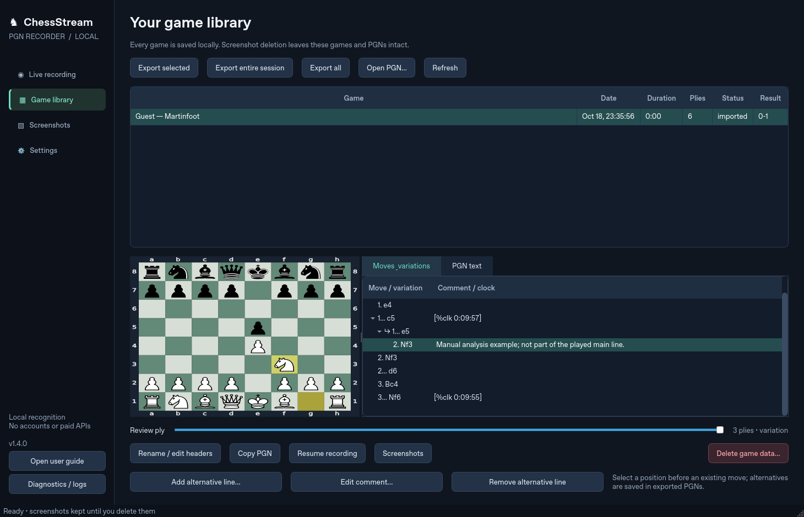

# ChessStream PGN Recorder

Short downloads: the development source is available on branch `dev`; new portable builds use `ChessStream.zip` containing a `ChessStream` folder. Extract near the drive root, such as `C:\ChessStream`, to avoid Windows path-length limits in bundled libraries.

Development build dev7 includes the [October 24 comprehensive check and fixes](docs/COMPREHENSIVE-CHECK-2026-10-24.md), including PGN setup headers, concurrent checks and combined failures.


Experimental playback move sounds are available in development version **1.6.24-dev7**. Enable Audio move cues on the live page. Built-in Chess.com and Lichess sound detectors require no learning. [Instructions and limits](docs/AUDIO-CUES.md).

**Development build 1.6.24.dev7** on [fix/non-destructive-pgn-gap-joins](https://github.com/understandingothers789-pixel/ChessStream-PGN-Recorder/tree/fix/non-destructive-pgn-gap-joins): the [comprehensive check](docs/COMPREHENSIVE-CHECK-2026-10-23.md) fixed a witnessed-capture gap that could block a recording, updated native dependencies after vendor-advisory review, and checked model output equivalence. See also the [search optimization measurements](docs/SEARCH-OPTIMIZATION-2026-10-23.md), [continuity changes](docs/GAP-CONTINUITY-2026-10-23.md) and [previous handoff implementation](docs/HANDOFF-IMPLEMENTATION-2026-10-20.md). This branch remains under review in draft PR #1; main is unchanged.

A local Python / PySide6 desktop application that reads a visible 2D chessboard from your screen, follows legal moves, optionally saves review screenshots, and exports standard PGNs. It does not need player usernames, a chess-site account, Nibbler, an engine, subscriptions, or chess/video APIs.

**Version 1.6.23 lets you combine older saved PGNs while a recording continues.** Select two or more saved games that do not include the active PGN; the combined copy is saved separately and the live recorder stays on its current game. Version 1.6.22 also prevents short replay fragments from switching the active PGN back and forth. See the [release notes](docs/RELEASE-v1.6.23.md), [game lifecycle validation](docs/GAME_LIFECYCLE.md), and [user guide](docs/USER_GUIDE.md).



Game library showing clock comments from the retained native browser capture and a manually added analysis variation.

## Install on Windows 11 x64

1. Download the ZIP from [GitHub Releases](https://github.com/understandingothers789-pixel/ChessStream-PGN-Recorder/releases/latest) and extract `ChessStream-PGN-Recorder-Portable.zip` to a folder you can write to, such as Documents. No installer, administrator access, or separate Python installation is needed.
2. Double-click `Launch ChessStream.cmd` in the extracted folder. The package includes a private Python runtime; it does not install software system-wide.
3. Place the app beside the browser or on a second monitor. The captured board must remain visible.
4. ChessStream automatically selects the most chess-related YouTube window and arms recording. A stable playable position starts recording automatically; the untouched starting position stays in preview. You can disable automatic recording in Settings or click **Start recording** to begin from another position. Nearby clocks/names are captured in a temporary margin. You can draw a capture region if you prefer.
5. Check the live preview and **Weakest square score**. The bundled model needs no initial calibration for the tested Chess.com/Lichess themes. An uncertain first position stays pending, with affected squares named. Screenshot images are not saved unless you enable them in Settings; frames are still analyzed in memory.
6. Verified moves have a checkmark. The reconstructed board ranks legal candidates against the classifier score on each square; recent clock movement can break close ties but cannot confirm a move. The amber preview is not in the PGN until confirmed. A board linked to an earlier position or short legal continuation stays with that game as review/analysis. A large unexplained change must remain stable for five seconds before a separate PGN starts from its FEN. Smaller unresolved changes use the separately configurable FEN timeout. Select **Start PGN from visible FEN** to start one immediately. **Copy visible FEN** copies the displayed position; if side to move is unknown, choose White or Black. Export from the live page or Game library. Unknown names stay `Unknown`.

After a detected result, the played main line is frozen. Post-game review can add side variations for two minutes by default. In Game library, select a position to add a legal SAN alternative or comment; exports retain them. **Diagnostics / logs** opens saved status messages and can export a support ZIP without screenshots.

The ZIP contains `pythonw.exe` as part of its private Python runtime, launched by the included `.cmd` shortcut script. No installer executable is required. Windows SmartScreen may still display warnings for unsigned downloaded scripts or binaries. The Windows workflow tests the bundled inference runtime and GUI before release. Live capture on your Windows 11 hardware remains a separate acceptance check.

## Run from source

Install official Python 3.12 or 3.13 x64, then run in PowerShell:

```powershell
py -3.13 -m venv .venv
.venv\Scripts\python -m pip install -e .
.venv\Scripts\python -m chessstream
```

`Launch-Windows.cmd` automates that first-time setup when a compatible Python is installed. Recognition assets are already included. Normal use makes no network requests.

To update a portable copy, stop and close the old app, extract the new ZIP into a separate folder, and launch the new copy. The default data directory is shared, so existing games and screenshots remain available. Back it up first if needed. Old verified moves are never silently rewritten; an older ambiguous recording can be resumed for further evidence or manually corrected.

For Linux development:

```sh
python3 -m venv .venv
.venv/bin/pip install -e '.[dev]'
.venv/bin/python -m chessstream
```

PySide6 requires a desktop session for interactive use. Headless GUI verification uses `QT_QPA_PLATFORM=offscreen`.

## Implemented functionality

- Region drawing and live move/resize overlay; monitor selection; Windows application-window selection with client-area tracking. On Windows, a drawn source remembers its containing window for board reacquisition after layout changes.
- Region-only MSS capture, screenshot image saving disabled by default, optional per-position or adjustable-interval saving, and adaptive temporary analysis frames (default six per second). Frames are analyzed in memory regardless of the image-saving setting. Arrow/cursor changes that preserve the recognized position do not create duplicate position-mode screenshots.
- OpenCV checkerboard localization, a bundled 1.3 MB pretrained 13-class screenshot CNN (fenshot, MIT), CPU inference through ONNX Runtime, optional manual template calibration, and an optional custom ONNX model imported into the app-managed models folder.
- Automatic orientation, explicit flip, legal multi-ply reconstruction, castling, en passant, promotion, and independent ambiguity branches. Changed squares require visual support. A reply or 0.5 seconds of unchanged position accepts the latest move. Timed acceptance and best-effort gap orders are annotated as inferred. Gap recovery may stop at its first legal match rather than exhaust equivalent orders. The most recent timed move can be corrected from retained earlier state; this does not prove what happened in unseen frames.
- Continuous verified-prefix PGNs, SQLite crash recovery, midgame FEN/SetUp, copy-visible-FEN and start-from-visible-FEN controls, automatic unresolved-position checkpoints, checkmate/stalemate handling, conservative reset/review handling, separate games, editable headers/results, import and multi-game export.
- Live preview, reconstructed board, SAN move list, confidence/similarity and storage indicators, game library with a move slider, screenshot thumbnails/timeline, observed positions and full-resolution review.
- Image-only deletion by game, session, date, range or all; confirmed future jobs; optional age retention; pending-job cancellation. Keep indefinitely is the default. Independent game-data deletion preserves screenshots and external exports.
- Windows global hotkeys when available (F8 start/pause/resume, F9 stop, Ctrl+Shift+R region), with focused Qt shortcuts as fallback. Configurable in Settings.

## Recognition and reconstruction boundaries

The default recognizer is the bundled MIT-licensed fenshot screenshot CNN, running offline through ONNX Runtime. Controlled browser tests cover Lichess and Chess.com pieces, textured boards, arrows, drag states, flips and compression. Those tests do not establish universal recognition accuracy. Optional calibrated templates remain available for unsupported artwork.

A held piece can look identical to a dropped piece. By default the latest move is accepted after 0.5 seconds of unchanged position, even without a reply, and marked as inferred. The latest timed suffix is retained for correction if later evidence identifies a different drop. At three seconds, an unresolved position produces a recovery error and bounded legal-gap retries while preserving the saved PGN. No legal connection within the limits means the recorder keeps its prefix instead of inventing an illegal move. Disabling **Protect against dragged pieces** accepts recognized legal moves immediately.

Observed live moves follow stable visual evidence and legal reconstruction under the shortest-gap search assumption and configured limits. Short opening prefixes may instead be explicitly guessed with pawn moves prioritized; the live list marks them with **≈** and PGN comments identify them. Different move orders can reach the same board, and unseen reversible cycles cannot be recovered. These checks cannot guarantee against visual misclassification.

Midgame pieces alone cannot prove turn, castling rights or an en passant target. Outside the short opening guess policy, the app infers turn from the next shortest legal transition and assumes **no castling rights / no en passant target** unless you provide an exact initial FEN. A PGN with unresolved evidence exports its established prefix with an explanatory comment; the latest provisional move stays excluded.

Opening reviews and new games can be visually indistinguishable. The app now checks visible positions against the verified history and short legal branches before splitting. Large, stable unexplained positions start a separate FEN PGN automatically; long reviews beyond bounded search may still be misclassified. Menus, advertisements and hidden boards do not change the saved game.

## Tests and measured evaluation

```sh
python -m pip install -e . pytest
python -m pytest -q
```

Routine validation now runs **15 essential tests**: shortest-path correctness against a small independent oracle, the reported Qxd4 gap, pending moves, ambiguity, PGN joining, results, storage/deletion, security boundaries, representative real Chess.com/Lichess images, OCR and desktop actions. The measured local run takes about **1.9 seconds**, versus **15.5 seconds** for the former 147-test suite. Duplicate GUI checks, repeated theme permutations, full-sequence recognition loops and generated-video tests were removed. These timings describe the development environment; Windows package assembly is separate.

The retained `tests/fixtures/real` contains **64 actual Chromium screenshots** captured from public Lichess and Chess.com analysis boards, with a manifest of known FENs and test moves. The broader corpus can be evaluated manually with `python scripts/evaluate.py`; it is no longer repeated during routine local validation. It is a controlled fixture set, not a YouTube stream benchmark. The optional search benchmark can be reproduced with `python scripts/benchmark_gap_search.py --baseline-ref f9b9594`; measured results are in [gap-search-v1.6.json](docs/gap-search-v1.6.json).

The recorded [evaluation](docs/evaluation.json) evaluates every existing real browser frame without calibration. The additional [recognition regression report](docs/recognition-v1.2.json) compares the original templates with the new model on textured boards and includes Chess.com Ocean/Walnut, analysis arrows, dragging, flips and compressed captures. These are controlled regression suites; they are not evidence of general YouTube accuracy. Your particular stream and capture still need checking.

An additional [live capture acceptance test](docs/live-capture-result.json) used headed Chromium on an actual X11 desktop with MSS and the production recording worker. It automatically verified seven of eight test plies, with one explicit final confirmation, checked pause/resume and a real board flip, and saved five position screenshots over 54 processed updates. Every measured complete sequence in the current reports includes one explicit final-move confirmation; the reports count that intervention. The former suite also checked a compressed MJPEG video and three consecutive real-image games; those repeated checks were removed from routine validation in v1.6.0. These Linux results do not validate Windows capture or YouTube streams.

`scripts/capture_fixtures.py` recreates the original browser fixtures. `scripts/capture_confirmation_fixtures.py` reproduces the continuation after `Bb6`, native blue arrows and a bishop held over `c5` before release at `b4`; `scripts/evaluate_confirmation.py` records the results. These use public browser UIs and known test PGNs. The application does not include any of those test sequences in its runtime behavior. Recognition examples are in `examples/*.pgn`; `gap-joined.pgn` is a controlled joining example based on manually transcribed user screenshot positions, with Qxd4 marked as inferred.

## Local video replay

The same vision and game-management pipeline can process a local prerecorded video:

```sh
python -m chessstream --data-dir ./replay-data --replay ./recording.mp4 --region 100,80,720,720 --orientation auto
```

Omit `--region` to locate the first board automatically. Replay reads frames locally; it does not download videos or consult site APIs. PGNs and screenshots are written under the selected data directory.

## Packaging

The portable ZIP contains official CPython 3.13.16 x64, pinned Windows wheels, ONNX Runtime, all source modules and offline recognition assets. It does not install system-wide or require a paid service. To rebuild, run:

```sh
python scripts/build_windows.py
```

The builder works on Linux and Windows. Windows wheels are downloaded explicitly for `win_amd64`, and a SHA-256 input manifest is included. An optional NSIS installer can still be built by passing `--makensis /path/to/makensis`; the portable ZIP is the recommended download. `.github/workflows/windows.yml` runs the compact Windows tests on pushes and pull requests; portable construction, packaged inference and launcher validation run on release tags or manual builds. Tagged releases are published only after these checks pass.

## Data and modules

Windows data: `%LOCALAPPDATA%\ChessStream PGN Recorder`. Use `--data-dir PATH` to override it. Back up the entire directory with the application closed.

| Module | Responsibility |
| --- | --- |
| `capture.py` | Windows DPI, sources, threaded screen capture and adaptive frames |
| `vision.py` | Board detection, template classification, calibration and ONNX |
| `reconstruction.py` | Bounded legal search, competing histories and commit rules |
| `games.py` | Sessions, reset/review tracking, game results and PGN generation |
| `storage.py` | SQLite, atomic PGN saving, images and durable deletion jobs |
| `gui.py`, `widgets.py`, `hotkeys.py` | Desktop interface, overlays and controls |
| `replay.py` | Local prerecorded-video ingestion |

The metadata database is `recordings.sqlite3`; images are under `screenshots/<session>/<game>/`; internal autosaves are under `pgn/`. Temporary adaptive frames exist only in memory. Recognition evidence metadata is retained on position/status changes, including frames for which no image is saved. Logs rotate independently. Deleting screenshots marks their records deleted without deleting game data.

See the [user guide](docs/USER_GUIDE.md), [architecture](docs/ARCHITECTURE.md), [stage report](docs/STAGES.md), [limitations](docs/KNOWN_LIMITATIONS.md) and [third-party notices](THIRD_PARTY_NOTICES.md).
