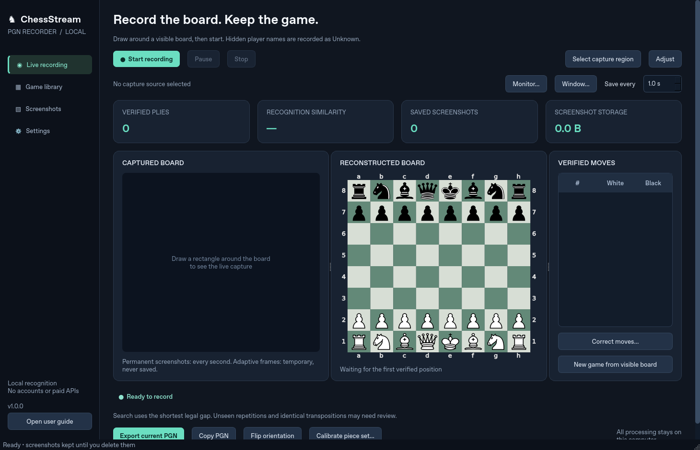

# ChessStream PGN Recorder

A local Python / PySide6 desktop application that reads a visible 2D chessboard from your screen, follows legal moves, saves review screenshots, and exports standard PGNs. It does not need player usernames, a chess-site account, Nibbler, an engine, subscriptions, or chess/video APIs.

**The implementation and installer are provided. The test host is Linux; the Windows installer has been assembled from official Windows binaries but has not been run on Windows 11 in this environment.** See [known limitations](docs/KNOWN_LIMITATIONS.md) before relying on unattended stream reconstruction.



## Install on Windows 11 x64

1. Run `dist/ChessStream-PGN-Recorder-Setup.exe` and install for your user. Administrator access and a separate Python installation are unnecessary.
2. Open **ChessStream PGN Recorder** from Start.
3. Place the app beside the browser or on a second monitor. The captured board must remain visible.
4. Select **Select capture region**, draw tightly around the 64 squares, and select **Start recording**.
5. For Chess.com's default Neo set or an unfamiliar set, show the **standard starting position**, choose **Calibrate piece set**, and confirm which color is at the bottom. This is one-time local calibration for that set and size; verify the preview afterward.
6. Export from the live page or Game library. Unknown names stay `Unknown`.

The unsigned installer may be identified as an unrecognized publisher by Windows. A source-based installation and a Windows CI build workflow are also supplied. No claim of Windows signing or completed Windows runtime validation is made.

## Run from source

Install official Python 3.12 or 3.13 x64, then run in PowerShell:

```powershell
py -3.13 -m venv .venv
.venv\Scripts\python -m pip install -e .
.venv\Scripts\python -m chessstream
```

`Launch-Windows.cmd` automates that first-time setup when a compatible Python is installed. Recognition assets are already included. Normal use makes no network requests.

For Linux development:

```sh
python3 -m venv .venv
.venv/bin/pip install -e '.[dev]'
.venv/bin/python -m chessstream
```

PySide6 requires a desktop session for interactive use. Headless GUI verification uses `QT_QPA_PLATFORM=offscreen`.

## Implemented functionality

- Region drawing and live move/resize overlay; monitor selection; Windows application-window selection with client-area tracking. On Windows, a drawn source remembers its containing window for board reacquisition after layout changes.
- Region-only MSS capture, adjustable permanent screenshot interval (default one second), and optional adaptive temporary frames (default six per second). Unchanged images reuse recognition results; image deduplication is separately opt-in.
- OpenCV checkerboard localization, a bundled local 13-class template model for five licensed piece sets, user-confirmed starting-position calibration, and a documented optional ONNX adapter.
- Automatic orientation, explicit flip, stability confirmation, legal multi-ply reconstruction, castling, en passant, promotion, and independent ambiguity branches. Incomplete searches cannot certify a unique path.
- Continuous verified-prefix PGNs, SQLite crash recovery, midgame FEN/SetUp, automatic checkmate/stalemate and board-provable endings, conservative reset/review handling, separate games, editable headers/results, import and multi-game export.
- Live preview, reconstructed board, SAN move list, confidence/similarity and storage indicators, game library with a move slider, screenshot thumbnails/timeline, observed positions and full-resolution review.
- Image-only deletion by game, session, date, range or all; confirmed future jobs; optional age retention; pending-job cancellation. Keep indefinitely is the default. Independent game-data deletion preserves screenshots and external exports.
- Windows global hotkeys when available (F8 start/pause/resume, F9 stop, Ctrl+Shift+R region), with focused Qt shortcuts as fallback. Configurable in Settings.

## Recognition and reconstruction boundaries

The default model is a transparent template classifier, not a claimed universal pretrained neural model. It supports Cburnett, Merida, Chessnut, Fantasy and Spatial artwork. The actual browser-image evaluation covers **default Cburnett on Lichess and calibrated default Neo on Chess.com**, not all bundled sets under real stream conditions. A starting-board calibration is necessary for unsupported sets. An optional model must be supplied separately to use ONNX.

“Verified” means supported by stable visual evidence and a unique legal path **under the shortest-gap search assumption and configured limits**. It is not a guarantee against visual misclassification. Different move orders can reach the same board. Completely unseen reversible cycles cannot be recovered. The app retains legal ambiguity instead of engine-ranking a human move into existence.

Midgame pieces alone cannot prove turn, castling rights or an en passant target. The app infers turn from the next shortest legal transition and assumes **no castling rights / no en passant target** unless you provide an exact initial FEN. Earlier moves are not invented. A PGN with unresolved evidence exports only its verified prefix with an explanatory comment.

Opening reviews and new games can be visually indistinguishable. After a nonterminal reset, the app waits for a legal opening that diverges from the prior game; you can explicitly start a separate game sooner. Menus, advertisements, a hidden board and unexplained position changes preserve the current game. Distinct unrelated midgames require confirmation rather than silent reassignment.

## Tests and measured evaluation

```sh
python -m pip install -e '.[dev]'
python -m pytest -q
python scripts/evaluate.py
```

The included `tests/fixtures/real` contains **64 actual Chromium screenshots** captured from public Lichess and Chess.com analysis boards, with a manifest of known FENs and test moves. Three are full Lichess games; the fourth is a 16-ply Chess.com opening. Chess.com calibration uses frame zero, with subsequent positions evaluated independently. This is a controlled fixture set, not a YouTube stream benchmark.

The recorded [evaluation](docs/evaluation.json) reconstructed all **60 expected plies**, exported PGNs that round-tripped through python-chess, and reproduced all four captured sequences when alternate frames were omitted. All **4,032 evaluated squares** were classified correctly; Chess.com's calibration frame is excluded from that score. Recognition plus reconstruction averaged approximately **130–165 ms per image** on the Linux CPU host. One of the four sequences required initial piece-set calibration; none required subsequent sequence correction. GPU, live browser overhead and Windows performance were not measured. Do not extrapolate these numbers to arbitrary video streams.

An additional [live capture acceptance test](docs/live-capture-result.json) used headed Chromium on an actual X11 desktop with MSS and the production recording worker. It reconstructed eight paired test plies, verified pause/resume and a real board flip, and saved interval screenshots independently of adaptive analysis. A compressed MJPEG video replay and three consecutive real-image games are also covered by automated tests. These Linux results do not validate Windows capture or YouTube streams.

`scripts/capture_fixtures.py` recreates the real-browser fixtures using the public UIs and known test PGNs. The application does not include any of those test sequences in its runtime behavior. `examples/*.pgn` are generated by the actual recognition pipeline from the captured sequences.

## Local video replay

The same vision and game-management pipeline can process a local prerecorded video:

```sh
python -m chessstream --data-dir ./replay-data --replay ./recording.mp4 --region 100,80,720,720 --orientation auto
```

Omit `--region` to locate the first board automatically. Replay reads frames locally; it does not download videos or consult site APIs. PGNs and screenshots are written under the selected data directory.

## Packaging

The installer contains official CPython 3.13.16 x64, pinned Windows wheels, all source modules and offline recognition assets. It does not require a paid service. To rebuild, install NSIS and run:

```sh
python scripts/build_windows.py --makensis /path/to/makensis
```

The builder works on Linux and Windows. Windows wheels are downloaded explicitly for `win_amd64`, and a SHA-256 input manifest is included. `.github/workflows/windows.yml` runs Windows tests, GUI rendering, packaged-runtime import checks and installer construction when the project is pushed to GitHub. That workflow has been supplied, not executed from this workspace.

## Data and modules

Windows data: `%LOCALAPPDATA%\ChessStream PGN Recorder`. Use `--data-dir PATH` to override it. Back up the entire directory with the application closed.

| Module | Responsibility |
| --- | --- |
| `capture.py` | Windows DPI, sources, threaded screen capture and adaptive frames |
| `vision.py` | Board detection, template classification, calibration and ONNX |
| `reconstruction.py` | Bounded legal search, competing histories and commit rules |
| `games.py` | Sessions, reset/review tracking, game results and PGN generation |
| `storage.py` | SQLite, atomic PGN saving, images and durable deletion jobs |
| `gui.py`, `widgets.py`, `hotkeys.py` | Desktop interface, overlays and controls |
| `replay.py` | Local prerecorded-video ingestion |

The metadata database is `recordings.sqlite3`; images are under `screenshots/<session>/<game>/`; internal autosaves are under `pgn/`. Temporary adaptive frames exist only in memory. Recognition evidence metadata is retained on position/status changes, including frames for which no image is saved. Logs rotate independently. Deleting screenshots marks their records deleted without deleting game data.

See the [user guide](docs/USER_GUIDE.md), [architecture](docs/ARCHITECTURE.md), [stage report](docs/STAGES.md), [limitations](docs/KNOWN_LIMITATIONS.md) and [third-party notices](THIRD_PARTY_NOTICES.md).
